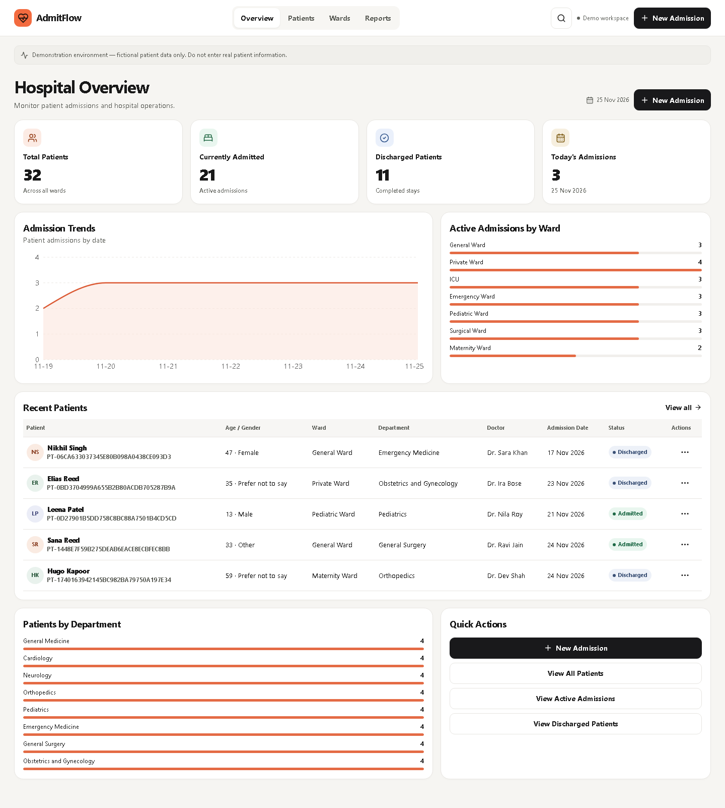

# AdmitFlow

AdmitFlow is the DScribe Round 1 patient admission management demo by Shadabur Rahaman. It uses a React and TypeScript SPA, a FastAPI REST API, and PostgreSQL for the hosted architecture. SQLite is the default for local development.

**Demonstration environment — fictional patient data only. Do not enter real patient information.**

## Features

- Admit, view, edit, discharge and permanently delete fictional patients. Discharge and deletion require confirmation.
- Search names and combine ward, department, doctor, status and admission-date filters. The API handles sorting and pagination.
- View the hospital overview, ward activity and date-filtered reports. Export the matching records as CSV.
- Enter data in a keyboard-accessible drawer with frontend and API validation.

## Screenshots



[Patient directory](screenshots/desktop-patients.png) · [New admission](screenshots/admission-drawer.png) · [Patient details](screenshots/patient-details.png) · [Wards](screenshots/ward-management.png) · [Reports](screenshots/reports.png) · [Mobile overview](screenshots/mobile-overview.png) · [Mobile directory](screenshots/mobile-patients.png)

## Local setup

Use Python 3.12 and Node 22 or later. In one terminal:

```powershell
cd backend
python -m pip install -r requirements.txt
alembic upgrade head
python -m app.seed
python -m uvicorn app.main:app --port 8000
```

In another terminal:

```powershell
cd frontend
npm install
npm run dev
```

Open [the local UI](http://localhost:5173) and [OpenAPI docs](http://localhost:8000/docs). The seed command adds 32 deterministic fictional patients and inserts missing catalog records without updating existing patients. Use `python -m app.seed --lookups-only` for catalog initialization.

## Architecture

React Router resolves the page and URL filters. TanStack Query loads API data and invalidates affected query keys following mutations. React Hook Form and Zod validate the drawer. FastAPI independently validates input with Pydantic, then SQLAlchemy runs the database operation. The patient table references wards and departments, and a composite foreign key enforces that the assigned doctor belongs to the selected department. Discharge is an atomic conditional update and retains the record. Alembic owns the schema.

## Checks

Run `python -m pytest -q` from `backend`, then `npm test` and `npm run build` from `frontend`. With both local servers running, run `npx playwright install chromium` and `npx playwright test` from `frontend`. Set `PLAYWRIGHT_BASE_URL` to test a different environment containing fictional data.

Verified locally using Python 3.14 and SQLite: **31 backend tests passed**, including reopening the database in a separate process. See [release status](docs/RELEASE_STATUS.md) for outstanding verification.

## Deploy

The public repository has been created. See the [release status](docs/RELEASE_STATUS.md) and [submission checklist](docs/FINAL_SUBMISSION_CHECKLIST.md) for deployment and acceptance status.

1. Use the dedicated Neon project named admitflow. The production branch has revision 0001 and 32 fictional records. Keep its connection string in the hosting environment and retain its TLS options.
2. Connect the public source repository to Render with the blueprint in `render.yaml`. Set `DATABASE_URL` to the Neon connection string. Enter the exact Vercel production origin in `ALLOWED_ORIGINS`. Render applies migrations and initializes the reference catalogs when starting.
3. In a Render shell or from an authorized local terminal configured for the same database, run `python -m app.seed` from `backend` once to populate the demo.
4. Import the repository in Vercel with `frontend` as the root and set `VITE_API_BASE_URL` to the HTTPS Render origin. Deploy and verify the API `/ready` endpoint and the complete workflow.
5. Add the verified live URLs to this README before submission.

Hosting documentation: [Render Blueprint](https://render.com/docs/blueprint-spec) · [Vite on Vercel](https://vercel.com/docs/frameworks/frontend/vite) · [Neon connection strings](https://neon.com/docs/connect/connect-from-any-app).

The public demonstration has no login. Access control, audit trails, retention controls and operational safeguards would be required before a deployment handling real patient information.

See [design notes](docs/DESIGN_REFERENCE_ANALYSIS.md) and the [Round 2 interview guide](docs/ROUND_2_INTERVIEW_GUIDE.md).
